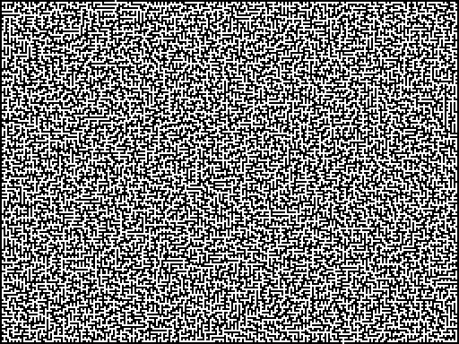

# MPath Benchmarks

This document contains detailed information about MPath's performance benchmarks and how to run them yourself.

## Complex Maze Pathfinding



*The complex maze used for benchmarking*

The following benchmark was run on a complex maze to test pathfinding performance. The test involved finding a path from coordinates (10, 10) to (502, 374) through a maze with narrow passages and dead ends. All benchmarks were implemented using [BenchmarkDotNet](https://benchmarkdotnet.org/).

### Implementation Comparison

| Method    | Mean      | Allocated   |
|---------- |----------:|------------:|
| MPath     |  4.802 ms |        42 B |
| [AStarLite](https://github.com/valantonini/AStar) |  7.623 ms |  8.75 MB |
| [RoyTAStar](https://github.com/roy-t/AStar) | 62.006 ms | 12.30 MB |
| [LinqToAStar](https://arc.net/l/quote/iqcsmlgc) | 5,809.5 ms | 108.13 MB |

MPath returns a cheapest route (its A* heuristic never overestimates the remaining cost). On this maze the narrow corridors leave little room for a better route; on open or randomly obstructed grids the exact cost model also cuts the number of expanded cells sharply.

These results highlight MPath's optimization for both speed and memory efficiency. Memory allocation in MPath is required only for the initial pathfinder creation and for the final path result creation, with no GC pressure during the pathfinding algorithm execution.

### Path Smoothing Comparison

The following benchmark compares different path smoothing options using the same maze and coordinates:

| Method                           | Mean      | Allocated | Path Length |
|--------------------------------- |----------:|----------:|-----------:|
| NoSmoothing                      |  5.579 ms | 24.07 KB  | 1078 |
| SimpleSmoothing                  |  5.552 ms | 24.06 KB  | 311 |
| StringPullingSmoothing           |  7.388 ms | 24.06 KB  | 202 |
| StringPullingSmoothingLargeAgent | 11.488 ms | 24.07 KB  | 401 |

The results show that:
- Simple smoothing adds negligible overhead compared to no smoothing
- String pulling smoothing adds about 32% overhead, but still maintains the same memory efficiency
- Path smoothing significantly reduces the number of steps in the path (SimpleSmoothing: 71% reduction, StringPullingSmoothing: 81% reduction)
- `StringPullingSmoothingLargeAgent` runs the same query with a 2x2 agent: every shortcut checks the agent's footprint at each cell, so both the search and the smoothing cost more

### Tie-Breaking Cost

`TieBreaking.None` (the default) runs the float search unchanged. A tie-break runs an integer-keyed search that also settles every route's cells before the cells after them, so it explores more on open ground with many equal-cost routes. Same maze and machine, `Cell[,]` grid:

| Query | None | FewerDiagonals | FewerTurns |
|-------|-----:|---------------:|-----------:|
| Maze path (10,10) to (502,374) | 4.83 ms | 5.63 ms | 5.87 ms |
| Reachability, budget 25 | 0.48 ms | 0.48 ms | 0.48 ms |
| Reachability, budget 1000 | 4.33 ms | 4.66 ms | 4.67 ms |
| 200x200 open grid, unit costs, (5,5) to (190,120) | 0.31 ms | 0.96 ms | 1.16 ms |

No mode allocates during the search.

## Benchmark Environment Specs

```
BenchmarkDotNet v0.14.0, macOS 26.6.2 (25G83) [Darwin 25.6.0]
Apple M1 Max, 1 CPU, 10 logical and 10 physical cores
.NET SDK 10.0.102
  [Host]     : .NET 7.0.20 (7.0.2024.26716), Arm64 RyuJIT AdvSIMD
  DefaultJob : .NET 7.0.20 (7.0.2024.26716), Arm64 RyuJIT AdvSIMD
```

## Measurement Legend

```
Mean      : Arithmetic mean of all measurements
Error     : Half of 99.9% confidence interval
StdDev    : Standard deviation of all measurements
Ratio     : Mean of the ratio distribution ([Current]/[Baseline])
Allocated : Allocated memory per single operation (managed only, inclusive, 1KB = 1024B)
1 ms      : 1 Millisecond (0.001 sec)
```

## Running Benchmarks

### .NET Benchmarks

The benchmark project is a small CLI (built with [Spectre.Console](https://spectreconsole.net/)).
Run it from the repository root and pass a command; add `--help` to see everything available.

```bash
# List all commands
dotnet run -c Release --project src/mpath-source/Migs.MPath.Benchmarks -- --help

# Maze comparison vs. other A* libraries (default suite)
dotnet run -c Release --project src/mpath-source/Migs.MPath.Benchmarks -- benchmark

# Other suites
dotnet run -c Release --project src/mpath-source/Migs.MPath.Benchmarks -- benchmark smoothing
dotnet run -c Release --project src/mpath-source/Migs.MPath.Benchmarks -- benchmark internal
dotnet run -c Release --project src/mpath-source/Migs.MPath.Benchmarks -- benchmark reachability
dotnet run -c Release --project src/mpath-source/Migs.MPath.Benchmarks -- benchmark grid
dotnet run -c Release --project src/mpath-source/Migs.MPath.Benchmarks -- benchmark short
dotnet run -c Release --project src/mpath-source/Migs.MPath.Benchmarks -- benchmark results
dotnet run -c Release --project src/mpath-source/Migs.MPath.Benchmarks -- benchmark layout

# Render result images / print path stats
dotnet run -c Release --project src/mpath-source/Migs.MPath.Benchmarks -- render
dotnet run -c Release --project src/mpath-source/Migs.MPath.Benchmarks -- info smoothing
```

### Movement-Range (Reachability)

The `reachability` suite measures `Pathfinder.GetReachable` — the bounded Dijkstra flood fill that returns
every cell within a movement budget. Because the work scales with the size of the reachable set, the suite
sweeps a small, medium and large budget over the same maze. Allocation stays at a few dozen bytes per query
thanks to the pooled result buffer.

### Random Walls

The `grid` suite runs corner-to-corner `GetPath` queries over seeded grids with 20% random walls. These grids are
mostly open, so the search keeps a wide frontier and the open set does more of the work than on the maze.

| Method              | Mean      | Allocated |
|-------------------- |----------:|----------:|
| RandomWalls_200x200 | 0.810 ms  |      36 B |
| RandomWalls_500x500 | 5.014 ms  |     138 B |

Allocation figures of a few dozen to a few hundred bytes are the result object plus, amortized, the pooled result
array: BenchmarkDotNet forces a full GC between iterations, which can make `ArrayPool<T>.Shared` drop its arrays, so
the first query of an iteration rents a fresh one. Outside the harness a query allocates only its result object.

### Short Queries on Large Grids

The `short` suite runs a 2-step and a 6-step `GetPath` and `GetReachable` from the center of 256x256 and 1024x1024
open `Cell[,]` grids, under both [`GridSnapshotMode`](../api/GridSnapshotMode.md)s. The search touches a handful of
cells, so the numbers are the per-query overhead: the copy of the matrix with `PerQuery`, nothing that scales with the
grid with `Manual`.

| Method              | Grid | PerQuery  | Manual   |
|-------------------- |-----:|----------:|---------:|
| GetPath_2Steps      |  256 | 0.153 ms  | 0.2 µs   |
| GetPath_6Steps      |  256 | 0.153 ms  | 0.4 µs   |
| GetReachable_2Steps |  256 | 0.154 ms  | 0.6 µs   |
| GetReachable_6Steps |  256 | 0.159 ms  | 5.0 µs   |
| GetPath_2Steps      | 1024 | 2.534 ms  | 0.2 µs   |
| GetPath_6Steps      | 1024 | 2.539 ms  | 0.4 µs   |
| GetReachable_2Steps | 1024 | 2.461 ms  | 0.6 µs   |
| GetReachable_6Steps | 1024 | 2.467 ms  | 5.1 µs   |

### Reading Results

The `results` suite measures reading results rather than computing them: enumerating the cross-maze `PathResult`
and a medium-budget `RangeResult` (the allocating `Path` / `Cells` iterators against `foreach` over the result,
`AsSpan()` and `Get(i)`), `CopyCostsTo`, and an O(1) `TryGetCost` for every reached cell of the range.

### Unity Benchmarks

Unity benchmark scenes are available in the Unity project:

1. Open the Unity project at `src/mpath-unity-project`
2. Open the benchmark scene at `Assets/MPath/Samples/Benchmarks`
3. Press play to run the benchmark scene
4. Results will be displayed in the Unity console 