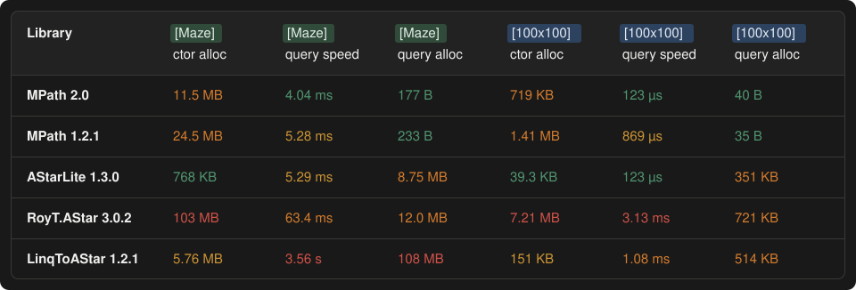

# What Changed in 2.0

The architectural changes in MPath 2.0 and what they measured against 1.2.1. For the code changes a caller has to make, see [Upgrading](upgrading.md); for the current numbers and how to run the benchmarks, see [Benchmarks](benchmarks/README.md).

## Results at a Glance

Same queries on the same machine (Apple M1 Max, .NET 7), with the 1.2.1 release and 2.0 benchmarked in alternation (1.2.1, 2.0, 1.2.1, 2.0). Each value is the mean of the two passes, which differed by under 3%. 2.0 runs its defaults (`PathCell[,]` matrix, `GridSnapshotMode.PerQuery`, `TieBreaking.None`); 1.2.1's float budgets match 2.0's integer budgets (25 → 2500). Every result is disposed.

| Query | 1.2.1 | 2.0 | 2.0, `Manual` snapshot | Allocated (1.2.1 → 2.0) |
|-------|------:|----:|-----------------------:|------------------------:|
| Maze path (10,10) to (502,374) | 5.34 ms | 4.22 ms | 4.19 ms | 34–42 B → 50 B |
| Reachability on the maze, budget 25 | 1.018 ms | 39.1 µs | 11.6 µs | 34 B → 72 B |
| Reachability on the maze, budget 100 | 1.173 ms | 179.8 µs | 150.4 µs | 34 B → 72 B |
| Reachability on the maze, budget 1000 | 4.97 ms | 3.66 ms | 3.62 ms | 42 B → 77 B |
| 200x200, 20% random walls, corner to corner | 4.16 ms | 0.676 ms | | 34–42 B → 41 B |
| 500x500, 20% random walls, corner to corner | 29.74 ms | 4.23 ms | | 72 B → 50–58 B |
| 2-step path, 256x256 open grid | 330 µs | 9.2 µs | 0.21 µs | 33 B → 40 B |
| 2-step path, 1024x1024 open grid | 5,439 µs | 173 µs | 0.21 µs | 42 B → 40 B |
| `TryGetCost` on each of 2,040 reached cells | 1,614 µs | 17.9 µs | | 2 B → 0 B |

Against other C# A* libraries, 2.0 and 1.2.1 side by side (.NET 8.0.21, same machine; query = one search with a reused pathfinder, ctor = building one pathfinder from a shared bool grid, never disposed; 100x100 has 20% random walls):

Table as text

| Library | Maze ctor alloc | Maze query | Maze query alloc | 100x100 ctor alloc | 100x100 query | 100x100 query alloc |
|---|---:|---:|---:|---:|---:|---:|
| **MPath 2.0** | 11.5 MB | 4.04 ms | 177 B | 719 KB | 123 µs | 40 B |
| MPath 1.2.1 | 24.5 MB | 5.28 ms | 233 B | 1.41 MB | 869 µs | 35 B |
| AStarLite 1.3.0-beta.1 | 768 KB | 5.29 ms | 8.75 MB | 39.3 KB | 123 µs | 351 KB |
| RoyT.AStar 3.0.2 | 103 MB | 63.4 ms | 12.0 MB | 7.21 MB | 3.13 ms | 721 KB |
| LinqToAStar 1.2.1 | 5.76 MB | 3.56 s | 108 MB | 151 KB | 1.08 ms | 514 KB |

Per-query allocation for both MPath versions is just the result object; the small difference between them is GC and pool noise.

Most of the gain comes from three changes: search state is reset lazily per query instead of clearing every cell, the open set is a fixed array heap, and range lookups are O(1). Each is described below.

## Search State Out of the Cell, Reset Lazily

In 1.2.1 the search wrote its scores, parent links and open/closed flags into the caller's cells, so every query first cleared the whole grid: a 2-step path paid for all 65,536 or 1,048,576 cells. In 2.0 the pathfinder owns its search state (24 bytes per cell, rented once from `ArrayPool` when it is created) and resets only the cells a query touches. The caller's cells are never written.

- Short queries: 330 µs → 9.2 µs on 256x256, 5,439 µs → 173 µs on 1024x1024 (30–36x). What remains is the per-query grid copy (see snapshot modes below).
- Small movement ranges: 1.018 ms → 39.1 µs (26x) at budget 25.
- The cell shrank from 56 bytes to 8 (`IsWalkable`, `IsOccupied`, `Weight`).

## Fixed Array Heap

The open set is a binary heap in an array rented once per pathfinder and sized to the grid (8 bytes per cell), instead of a buffer that grew during the search. A search never allocates or resizes, which matters most on open grids where the frontier is wide.

## Int Costs and an Optimal Search

Costs are `int` everywhere (step costs default to 100 / 141, plus the entered cell's weight), with no floats and no hidden scale. A step costs the same in `GetPath` and `GetReachable`, and the A* heuristic never overestimates, so `GetPath` returns a cheapest route; 1.2.1 could return a longer one. Exact costs also let the search expand far fewer cells on open ground:

- 20% random walls: 4.16 ms → 0.676 ms on 200x200, 29.74 ms → 4.23 ms on 500x500 (6–7x).
- The maze path: 5.34 ms → 4.22 ms (about 21% faster). Its narrow corridors leave little room for a better route.

Integer costs made deterministic tie-breaking possible (`TieBreaking.FewerDiagonals`, `FewerTurns`): a keyed search that orders equal-cost routes. It is off by default and costs 21–25% on the maze and about 2–3x on open grids with many equal-cost routes.

## Grid Snapshot Modes

A `PathCell[,]` or `ICellHolder` pathfinder searches a pooled snapshot of the grid. `GridSnapshotMode.PerQuery` (the default) copies it before every query, as in 1.2.1; `GridSnapshotMode.Manual` copies it once and again only after `Refresh()`. The `Set*` cell-update methods write to both the matrix and the snapshot in O(1), so they need no `Refresh()`.

- 2-step path with `Manual`: 0.21 µs on both 256x256 and 1024x1024, against 330 µs and 5,439 µs in 1.2.1 (up to 25,000x).
- Reachability, budget 25 with `Manual`: 11.6 µs.

## Cell Layouts

A flat `PathCell[]` is searched in place, without a copy, in the order `CellLayout` declares (`ColumnMajor` or `RowMajor`). A cell's slot is its position, so cells carry no coordinate. 1.2.1 sorted the caller's array into column-major order by each cell's `Coordinate`. With no snapshot, an array grid costs the same in both snapshot modes: 0.21 µs for a 2-step path on 256x256.

## Per-Query Options

`QueryOptions` changes the occupancy rule or makes specific cells enterable for one query, without touching the settings or the grid. The options are resolved into a small struct that the neighbour check reads; a query without options pays nothing for them. Queries whose rules differ from the settings bypass the path cache.

## Results

- `RangeResult.Contains`, `TryGetCost` and `TryGetCell` are O(1) through an index the result builds on its first lookup: `TryGetCost` on each of 2,040 reached cells went from 1,614 µs to 17.9 µs (90x).
- `PathResult.Path` and `RangeResult.Cells` are struct sequences that share the result's struct enumerator. 1.2.1's `yield` iterators allocated on every `foreach` and were slower. Iterating a result now allocates 0 B, down from 48–56 B (1,078-cell path, 2,040-cell range):

| Iteration | 1.2.1 | 2.0 |
|------|------:|----:|
| `foreach` over `PathResult.Path` | 5.84 µs, 48 B | 0.75 µs, 0 B |
| `foreach` over `RangeResult.Cells` | 9.22 µs, 56 B | 1.57 µs, 0 B |
| `foreach` over the result, or over `AsSpan()` | | 0 B |

- String-pulling smoothing writes into an array rented from `ArrayPool`, so a smoothed query allocates no more than an unsmoothed one.

## Trade-off: Construction Cost

Moving search state into the pathfinder makes building one more expensive. Over the maze (196,608 cells):

| Construction | 1.2.1 | 2.0 |
|------|------:|----:|
| `new Pathfinder(PathCell[,])`, disposed | 54 ns, 320 B | 46 µs, 312 B |
| `new Pathfinder(PathCell[,])`, not disposed | 41.6 µs, 14.0 MB | 424 µs, 10.0 MB |
| `new Pathfinder(PathCell[], w, h)`, not disposed | 38 ns, 320 B | 413 µs, 8.0 MB |

On a small 100x100 grid (10,000 open cells), from the matrix constructor (`Cell[,]` in 1.2.1, `PathCell[,]` in 2.0). "Cold pool" builds a pathfinder that is never disposed, so every construction rents fresh arrays; "warm pool" constructs and disposes repeatedly, so the arrays come back from `ArrayPool`:

| Construction, 100x100 | 1.2.1 | 2.0 |
|------|------:|----:|
| Warm pool (construct + dispose) | 53 ns, 320 B | 2.5 µs, 315 B |
| Cold pool (first construction, not disposed) | 9.5 µs, 896 KB | 23.8 µs, 640 KB |

Measured with BenchmarkDotNet on the same machine, alternating 1.2.1 and 2.0 (1.2.1, 2.0, 1.2.1, 2.0); the 2.0 case is in the `internal` suite. Construction scales with the cell count: about 2.4 ns per cell cold and 0.25 ns per cell warm (clearing the search nodes). From a matrix, 2.0 rents 40 B per cell (a 24-byte search node, an 8-byte heap slot and an 8-byte snapshot cell; 32 B from an array, which has no snapshot) against 1.2.1's 56-byte `Cell`, rounded up by `ArrayPool` to a power of two (16,384 slots for 10,000 cells).

1.2.1's array constructor was nearly free because it searched the caller's array in place, keeping search state in the cells and sorting the array. Build a pathfinder once per grid and dispose it, rather than once per query.
